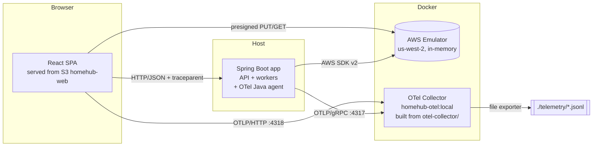
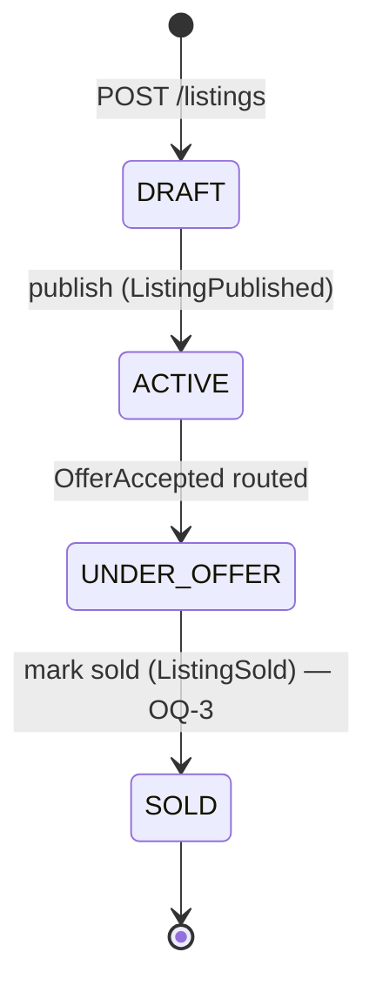
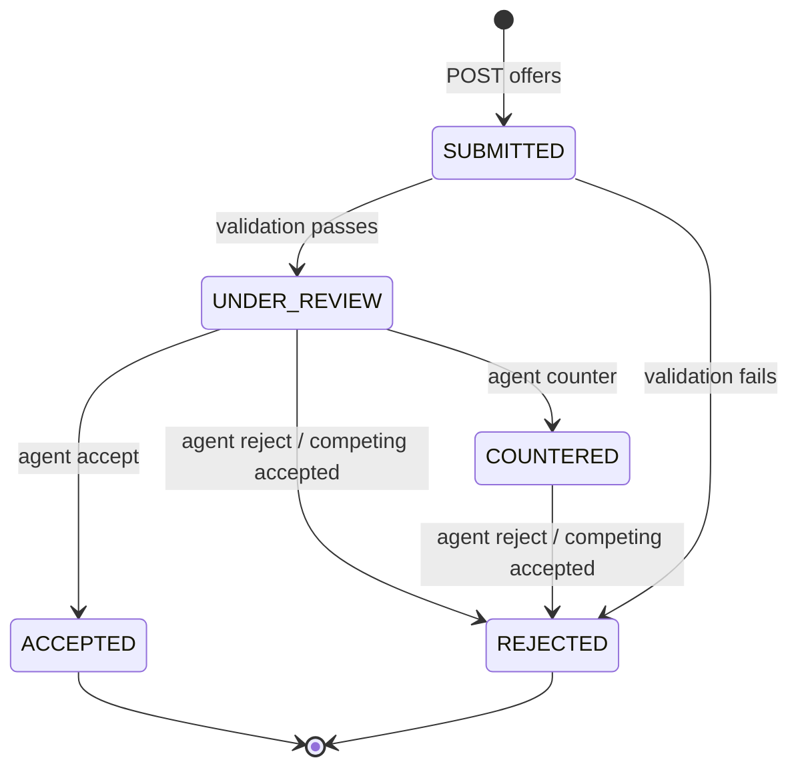

# HomeHub — Design

Status: **Draft v0.1**. Items tagged `(proposed)` are design choices made here
that CLAUDE.md doesn't specify. They need sign-off at the Phase 2 review and
are recorded in `decisions.md`.

## 1. Architecture



One deployable runs the HTTP API **and** the SQS consumers (photo worker,
search matcher, offer processor). Splitting them into separate services is a
later lesson. On real AWS they would typically be separate Lambda functions
or ECS services, so that each can scale independently.

### 1.1 Backend package layout (proposed)
```
com.homehub
  api/            controllers, request/response DTOs, problem+json handler, ActorFilter
  domain/         Listing, Offer, SavedSearch, state machines, validators — no AWS types
  service/        ListingService, OfferService, SearchService, PhotoService, AlertService
  port/           interfaces: ListingRepository, EventPublisher, CommandQueue, PhotoStore, Notifier
  adapter/aws/    DynamoDB/S3/SQS/SNS/EventBridge/CloudWatch implementations of ports
  worker/         SQS listeners: PhotoWorker, SearchMatchWorker, OfferProcessor
  config/         HomeHubResources (ALL names), AwsClientConfig, profiles
  bootstrap/      InfraBootstrapRunner(@Order 1), SeedDataLoader(@Order 2)  ← code shared with infra/bootstrap
  health/         per-service HealthIndicators + SeedDataHealthIndicator
  telemetry/      span/attribute name constants, DomainEventLogger
```
Ports are what make the "no AWS SDK types in controllers or domain" ArchUnit
rule practical. They also let unit tests mock at the port, not at the SDK.

## 2. Configuration

| Property | local | aws |
|---|---|---|
| `homehub.aws.endpoint` | `${AWS_ENDPOINT_URL}` (required) | unset |
| `homehub.aws.region` | `us-west-2` | from env |
| `homehub.bootstrap-infra` | `true` | `false` (startup guard rejects `true`) |
| `homehub.seed-data` | `true` | `false` (startup guard rejects `true`) |
| `homehub.cors.allowed-origins` | UI origin(s) — S3 website URL + Vite dev URL | n/a |
| `homehub.seed.path` | `../test/data` | n/a |

Credentials: never in config. `run-local.sh` exports the emulator's current
`AWS_ACCESS_KEY_ID`/`AWS_SECRET_ACCESS_KEY` (mechanism 🔬 V-3), and the SDK's
default chain picks them up.

## 3. AWS resources

All names below live in `config/HomeHubResources.java` (proposed name).

### 3.1 DynamoDB (all on-demand / PAY_PER_REQUEST)

**`Listings`**
| Attribute | Type | Notes |
|---|---|---|
| `listingId` (PK) | S | `LST-0001` (fixtures) / `LST-<ULID>` (created) |
| `agentId` | S | |
| `status` | S | DRAFT, ACTIVE, UNDER_OFFER, SOLD |
| `address`, `city`, `state`, `zip` | S | property address (not buyer PII, so allowed in data but kept out of telemetry anyway) |
| `price` | N | whole USD |
| `beds`, `baths`, `sqft` | N | |
| `description` | S | |
| `photos` | L of M | `{photoId, originalKey, thumbnailKey?, status}` |
| `searchCity` | S | **sparse**: lower-cased city, set only while status ∈ {ACTIVE, UNDER_OFFER}; removed otherwise |
| `version` | N | optimistic lock |
| `createdAt`, `updatedAt` | S | ISO-8601 |

GSIs:
- `city-price-index`: PK `searchCity`, SK `price`. Because the index is
  sparse, DRAFT and SOLD listings are simply not in it. This is a DynamoDB
  pattern worth learning: the search never has to filter them out.
- `agent-index`: PK `agentId`, SK `createdAt`.

**`Offers`**
| Attribute | Type | Notes |
|---|---|---|
| `listingId` (PK) | S | |
| `offerId` (SK) | S | `OFR-0001` / `OFR-<ULID>` |
| `buyerId` | S | |
| `amount` | N | whole USD |
| `counterAmount` | N | when COUNTERED |
| `status` | S | SUBMITTED, UNDER_REVIEW, COUNTERED, ACCEPTED, REJECTED |
| `rejectionReason` | S | enum, see §5.2 |
| `version` | N | optimistic lock |
| `lastCommandId`, `eventPublished` | S, BOOL | idempotent-consumer bookkeeping (§6.3) |
| `createdAt`, `updatedAt` | S | |

GSIs:
- `buyer-index`: PK `buyerId`, SK `createdAt`. For "my offers".
- `offer-id-index` (proposed, KEYS_ONLY): PK `offerId`. Needed because
  `POST /offers/{id}/accept` only has the offerId, while the table key is
  (listingId, offerId). Alternative: put `listingId` in the path. See OQ-10.

**`SavedSearches`**
| Attribute | Type | Notes |
|---|---|---|
| `buyerId` (PK) | S | |
| `savedSearchId` (SK) | S | `SS-001` / `SS-<ULID>` |
| `city`, `minPrice`, `maxPrice`, `minBeds` | S/N | |
| `notify` | BOOL | |
| `notifyCity` | S | **sparse**: lower-cased city, set only when `notify=true` |
| `lastNotified` | M | `{listingId → price}` for de-duplicating alerts (OQ-5) |

GSI `notify-city-index`: PK `notifyCity`. The matcher Queries by the
listing's city, so it never Scans the whole table.

### 3.2 S3
| Bucket | Config |
|---|---|
| `homehub-listing-photos` | CORS: PUT/GET from UI origins, `ETag` exposed. Event notification `s3:ObjectCreated:*` with prefix `listings/` suffix filter none → `photo-processing-queue` 🔬 V-6. Keys: `listings/{listingId}/original/{photoId}.{ext}`, `listings/{listingId}/thumbnails/{photoId}.jpg`. Notification filtered on `/original/` by worker (S3 filters only support prefix/suffix). |
| `homehub-documents` | private. Keys `offers/{offerId}/{docType}.pdf`. (Not used by any v1 endpoint, see OQ-11.) |
| `homehub-web` | website hosting: index `index.html`, error `index.html`. Public-read policy for website (not enforced locally). |

### 3.3 SQS
| Queue | Type | Visibility timeout | DLQ |
|---|---|---|---|
| `photo-processing-queue` | standard | 60s | `photo-processing-dlq`, maxReceiveCount 3 |
| `search-match-queue` | standard | 30s | `search-match-dlq`, 3 |
| `offer-processing-queue.fifo` | FIFO, content-based dedup **off** | 30s | `offer-processing-dlq.fifo`, 3 |
| `buyer-alerts-test-queue` (proposed) | standard, subscribed to SNS, raw delivery | 30s | none |

A FIFO queue's DLQ must also be FIFO (AWS rule). Long polling (20s) is used
for all consumers.

### 3.4 SNS
`homehub-buyer-alerts` (standard). Message attributes: `buyerId`,
`alertType` (`OFFER_STATUS` | `SAVED_SEARCH_MATCH`). On real AWS, per-buyer
delivery would use subscription filter policies on `buyerId`. Locally the
only subscription is the test queue.

### 3.5 EventBridge
Bus `homehub-events`. Rules:
| Rule | Pattern | Target |
|---|---|---|
| `listing-to-search-match` | `detail-type` ∈ [ListingPublished, PriceChanged] | `search-match-queue` |
| `offer-accepted-to-processor` | `detail-type` = OfferAccepted | `offer-processing-queue.fifo`, `MessageGroupId` = `$.detail.listingId` 🔬 V-8 |
| `offer-outcomes-to-alerts` | `detail-type` ∈ [OfferAccepted, OfferRejected, OfferCountered] | SNS `homehub-buyer-alerts` (input transformer adds `buyerId`) 🔬 V-8 |

### 3.6 CloudWatch, Logs, Secrets, SSM
- Metrics namespace `HomeHub` (R-CW-01), dimension `Environment=local`.
- Alarms: `homehub-photo-failures`, `homehub-<queue>-dlq-depth` ×3.
- Log group `/homehub/api`, stream `{hostname}-{startTime}`, retention 7 days.
  Shipped by a non-blocking async logback appender that batches
  `PutLogEvents`. Its own SDK calls are **excluded from tracing**, otherwise
  every log write would create a span, which would get logged, and so on.
- Secret `homehub/local/geocoding-api-key` (a dummy value created by bootstrap).
- SSM: `/homehub/local/feature-flags/{flag}` (String). Resource-name
  parameters: see OQ-6.

## 4. REST API

### 4.1 Common
- JSON only. Errors use RFC 9457 `application/problem+json` with
  `type`, `title`, `status`, `detail`, and optional `errors[]` `{field, message}`.
- **Caller identity (proposed, OQ-1):** header `X-HomeHub-User: BUY-004`.
  The role comes from the prefix (`AGT`→agent, `BUY`→buyer). A missing or
  malformed header gets `401`. This is a placeholder that stands in for
  Cognito/JWT. The ActorFilter that reads it is the same place that sets
  the who-invoked span attributes.
- Optimistic concurrency over HTTP: the response carries
  `ETag: "<version>"`. `PATCH` requires `If-Match`. Missing → `428`;
  stale → `412`.
- Pagination: `?limit=&nextToken=`, where `nextToken` is opaque base64 of
  DynamoDB's `LastEvaluatedKey`. (On real AWS, encrypt or sign it, because
  it exposes key structure.)
- Monetary values are integers in whole USD.

### 4.2 Endpoints
| Method & path | Caller | Success | Notes |
|---|---|---|---|
| `POST /listings` | agent | 201 | body: address, city, state, zip, price, beds, baths, sqft, description |
| `GET /listings/{id}` | any | 200 | DRAFT only to owner, else 404 |
| `PATCH /listings/{id}` | owner | 200 | JSON merge-patch subset; `If-Match` |
| `POST /listings/{id}/publish` | owner | 200 | DRAFT→ACTIVE |
| `POST /listings/{id}/photos/upload-url` | owner | 201 | → `{photoId, uploadUrl, expiresAt, requiredHeaders}` |
| `GET /listings/{id}/photos` | any | 200 | → `[{photoId, url, thumbnailUrl?, thumbnailStatus}]` |
| `GET /listings/search` | any | 200 | → `{items[], nextToken?}` |
| `POST /listings/{id}/offers` | buyer | 202 | body `{amount}` |
| `GET /listings/{id}/offers` | owner/buyer | 200 | buyer sees only own |
| `POST /offers/{id}/accept` | listing owner | 202 | |
| `POST /offers/{id}/reject` | listing owner | 202 | body `{reason?}` |
| `POST /offers/{id}/counter` | listing owner | 202 | body `{counterAmount}` |
| `POST /buyers/{id}/saved-searches` | that buyer | 201 | |
| `GET /buyers/{id}/saved-searches` | that buyer | 200 | |
| `GET /buyers/{id}/offers` (proposed, OQ-7) | that buyer | 200 | needed by buyer view |
| `POST /listings/{id}/sold` (proposed, OQ-3) | owner | 200 | UNDER_OFFER→SOLD |
| `GET /actuator/health` | any | 200 | |

springdoc-openapi serves `/v3/api-docs` and `/swagger-ui.html`. The frontend
build runs `openapi-typescript` on a spec file exported during the backend
build (`backend/target/openapi.json`), so generating frontend types doesn't
need a running app.

## 5. State machines

### 5.1 Listing

`ACTIVE`→`ACTIVE` price changes emit `PriceChanged`. `UNDER_OFFER`→`ACTIVE`
(the deal falls through) is out of scope for v1 (OQ-3).

### 5.2 Offer

"Open" = {SUBMITTED, UNDER_REVIEW, COUNTERED}. How a buyer responds to a
counter is not specified (OQ-2).
`rejectionReason` ∈ {LISTING_NOT_ACTIVE, INVALID_AMOUNT, DUPLICATE_OPEN_OFFER,
AGENT_REJECTED, COMPETING_OFFER_ACCEPTED}.

The state machine is a pure domain class (`OfferStateMachine.transition(from,
command) → Result`) that is unit-tested exhaustively, covering every
(state × command) pair.

## 6. Messages & events

### 6.1 Offer commands (FIFO queue body)
```json
{ "commandId": "OFR-0042:ACCEPT", "type": "AcceptOffer",
  "listingId": "LST-0007", "offerId": "OFR-0042",
  "counterAmount": null, "issuedAt": "…" }
```
`type` ∈ SubmitOffer, AcceptOffer, RejectOffer, CounterOffer,
CloseCompetingOffers (from the EventBridge rule).
`MessageGroupId=listingId`.
`MessageDeduplicationId = commandId = {offerId}:{COMMAND}` (proposed).
**This deliberately differs from CLAUDE.md's `=offerId`** (OQ-8). FIFO
de-duplicates within a 5-minute window, so if the id were only `offerId`,
an agent accepting within 5 minutes of submission would have the accept
silently dropped as a duplicate of the submit.
Message attributes: `traceparent` (injected by the agent, §8.3) and
`homehub.enduser.id`.

### 6.2 Domain events (EventBridge `detail`)
Envelope: `source=homehub.api|homehub.worker`, `detail-type=<EventName>`.
```json
{ "meta": { "eventId": "<ULID>", "occurredAt": "…", "traceparent": "00-…",
            "enduserId": "BUY-004" },
  "listingId": "LST-0007", "offerId": "OFR-0042", "buyerId": "BUY-004",
  "agentId": "AGT-002", "...": "event-specific fields" }
```
| detail-type | event.name (OTel log) | extra fields |
|---|---|---|
| ListingPublished | `homehub.listing.published` | city, price, beds |
| PriceChanged | `homehub.listing.price_changed` | oldPrice, newPrice, city, beds |
| ListingSold | `homehub.listing.sold` | |
| OfferSubmitted | `homehub.offer.submitted` | amount |
| OfferAccepted | `homehub.offer.accepted` | amount |
| OfferRejected | `homehub.offer.rejected` | reason |
| OfferCountered | `homehub.offer.countered` | counterAmount |

The detail holds only ids and numbers, never names, emails or addresses
(R-PII-01). That matters because events end up in SNS messages and
telemetry.

### 6.3 Idempotent consumers
SQS is at-least-once (FIFO dedup only covers sends within 5 minutes). So
the processor handles each command like this:
1. Conditional write: apply the transition `IF version = :v AND lastCommandId <> :cmd`,
   setting `lastCommandId=:cmd, eventPublished=false`.
2. Publish the domain event, then set `eventPublished=true`.
3. On redelivery: if `lastCommandId = cmd` and `eventPublished=false`,
   republish (the crash happened between steps 1 and 2). If
   `eventPublished=true`, just acknowledge the message.

This is a simplified **transactional outbox**. The real-AWS alternative is
DynamoDB Streams → EventBridge Pipes. That can be a later lesson if the
emulator supports Streams (🔬 V-9).

## 7. Workers

| Worker | Queue | Concurrency | Span | Behavior |
|---|---|---|---|---|
| OfferProcessor | offer FIFO | 1 poller; FIFO serializes per group | `process-offer-command` → `validate-offer`, `transition-offer-status` | §6.3 |
| PhotoWorker | photo | 2 | `process-photo` → `generate-thumbnail` | S3 event → thumbnail (Thumbnailator or ImageIO) → `add-photo` with lock retry |
| SearchMatchWorker | search-match | 2 | `match-saved-searches` | Query `notify-city-index`, filter criteria in code, publish SNS per match |

### 7.1 Listener tech
Spring Cloud AWS `@SqsListener` (proposed). If it doesn't work against the
emulator, the fallback is a small hand-written `ReceiveMessage` loop. Either
way, the processing logic sits behind a plain method so it can be
unit-tested.

### 7.2 Retries
Optimistic-lock conflicts are retried in-process (3 attempts, jittered
backoff of 50–200 ms). Any other exception propagates, the message is not
deleted, the visibility timeout expires, and SQS redelivers it.

### 7.3 Dead-letter visibility
When handling fails and `ApproximateReceiveCount ≥ maxReceiveCount`, the
worker records a `message.dead_lettered` span event, increments
`homehub.messages.dead_lettered{queue}`, and logs once. SQS then moves the
message to the DLQ itself. This needs no DLQ poller, and the CloudWatch DLQ
depth alarm stays as the AWS-native signal.

## 8. Telemetry

### 8.1 Who-invoked (ActorFilter, once per request)
`Span.current()` (the agent's server span) gets `enduser.id`,
`homehub.actor.role`, `client.address`, `user_agent.original`. This happens
after the identity header is parsed. Requests without identity get role
`anonymous` (proposed, used for health and swagger).

### 8.2 Critical-juncture spans & events
| Span | Where | Attributes | Events |
|---|---|---|---|
| `bootstrap-infra` (+ `bootstrap-<type>`) | runner | `homehub.resources.created` | |
| `load-seed-data` | runner | counts | `seed.skipped` |
| `validate-offer` | processor | offer/listing/buyer ids, `homehub.outcome` | `offer.rejected{reason}` |
| `transition-offer-status` | processor | ids, `homehub.offer.status.from/to` | `optimistic-lock.retry{attempt}` |
| `transition-listing-status` | ListingService | listing id | `listing.status.changed{from,to}` |
| `match-saved-searches` | worker | listing id | `search.matched{count}` |
| `process-photo`, `generate-thumbnail` | worker | listing id, `homehub.photo.key` | |
| `process-offer-command` / `handle-<queue>-message` | each listener | `messaging.message.id`, ids | `message.dead_lettered` |

Attribute and span names are constants in `telemetry/HomeHubTelemetry.java`.

### 8.3 Context propagation across async hops
- **HTTP**: W3C `traceparent` header. The browser SDK adds it to fetch
  calls (CORS must allow and expose the header), and the agent extracts it.
- **SQS**: The OTel Java agent's AWS SDK instrumentation can inject trace
  context into SQS message attributes when it sends, and extract it when it
  receives, so the receive/process span becomes a child of the send. This
  is controlled by
  `OTEL_INSTRUMENTATION_AWS_SDK_EXPERIMENTAL_USE_PROPAGATOR_FOR_MESSAGING=true`
  (**verify the name against the pinned agent version's docs**). SQS allows
  only 10 message attributes, so keep ours to a minimum.
- **EventBridge**: The agent does **not** propagate through PutEvents. We
  write `traceparent` into `detail.meta` ourselves. When a rule delivers
  the event to SQS, the message body is the event envelope. The consumer
  reads `detail.meta.traceparent` and starts its span as a child (single
  message) or with a span link (batch).
- **SNS**: same approach. We set `traceparent` as an SNS message attribute,
  or rely on the agent if it injects for SNS (verify).
- **S3 → SQS (photos)**: The browser uploads directly to S3, so there's no
  trace context in the S3 event. Option (proposed): sign `x-amz-meta-traceparent`
  into the presigned PUT. The worker does a HeadObject, reads the metadata,
  and links its span to the upload trace. Without that, photo processing
  starts a new trace.

### 8.4 Agent env (run-local.sh and Failsafe)
As in CLAUDE.md, plus `OTEL_LOGS_EXPORTER=otlp`, `OTEL_METRICS_EXPORTER=otlp`,
`OTEL_TRACES_EXPORTER=otlp`. The pinned agent version is recorded in
`run-local.sh` and in `decisions.md`.

### 8.5 PII scan test
Uses `OpenTelemetryExtension` (sdk-testing). It drives the services through
representative flows, collects all spans, events, and log records, and fails
on any match of the patterns in R-PII-02.

## 9. Test harness

- **Surefire** `*Test.java` and **Failsafe** `*IT.java`. JaCoCo runs with
  two agents/executions: `jacoco-ut.exec` (prepare-agent) and
  `jacoco-it.exec`.
- **Functional-coverage trick:** the app under test runs as a separate JVM
  (with the OTel agent attached), so its JaCoCo agent must also be attached
  to *that* JVM. Plan: Failsafe `pre-integration-test` starts the app via
  `spring-boot:start` with `-javaagent:jacoco=destfile=jacoco-it.exec` and
  the OTel `-javaagent`, and `post-integration-test` runs `spring-boot:stop`.
  Two `-javaagent` flags on one JVM are fine.
- ITs wait on `/actuator/health` = UP (Awaitility, 120s) before running.
- **Frontend:** Vitest (MSW handlers typed from the generated OpenAPI types).
  Playwright runs against the S3 website URL of an instrumented build
  deployed to `homehub-web` *temporarily*. After the run, the normal build
  is redeployed, so the instrumented build is never the one left in place.
  An alternative is a separate `homehub-web-e2e` bucket (OQ-12).
- Cleanup: tests that create entities use new ULID ids, so they never
  collide with fixtures and need no teardown. An emulator restart resets
  everything.
